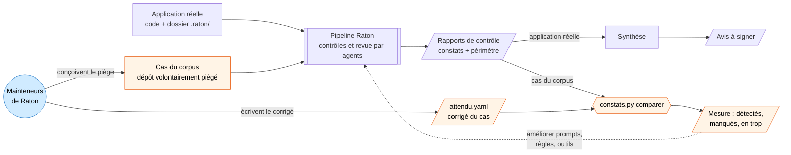
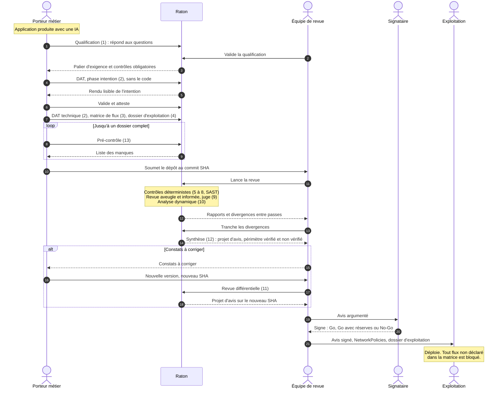
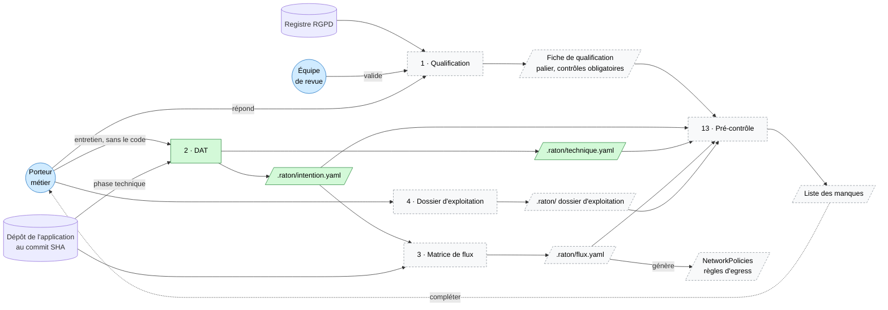
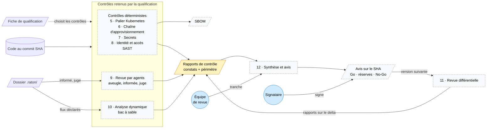
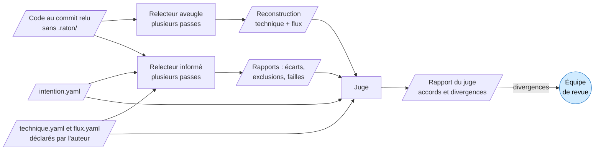

# Architecture

Ce document montre comment s'enchaînent les skills, ce qu'ils lisent et produisent, et où interviennent les humains. Il suit la [feuille de route](feuille-de-route.md) ; les rôles qu'elle ne fixe pas encore sont rassemblés à la fin, dans [Hypothèses à confirmer](#hypothèses-à-confirmer).

Code couleur des skills et des formats :

- vert : en place ;
- jaune : proposé, à valider ;
- gris pointillé : à faire.

## 1. Un même pipeline, deux usages

Raton sert à relire de vraies applications, mais il faut aussi savoir ce qu'il vaut : une revue qui ne trouve rien ne prouve rien si l'on ignore ce qu'elle sait trouver. Le même pipeline tourne donc dans deux boucles.

**Boucle de production** (en haut) : une application réelle passe dans le pipeline, les rapports sont synthétisés en un avis que l'entreprise signe. Il n'y a pas de corrigé : personne ne sait d'avance ce que contient l'application.

**Boucle de mesure** (en bas, en orange) : c'est le contrôle qualité de Raton lui-même, l'équivalent de tests unitaires pour les relecteurs.

- **Qui écrit `attendu.yaml` ?** Les mainteneurs de Raton, c'est-à-dire l'équipe qui développe la bibliothèque, au moment où ils construisent un cas piégé. Ils savent ce qu'ils ont caché ; le corrigé l'écrit dans le format des constats.
- **Le corrigé n'entre jamais dans le pipeline.** Les relecteurs ne voient que `depot/`. Le corrigé n'intervient qu'après, pour noter leurs rapports.
- **À quoi sert la comparaison ?**
  - **Mesurer la détection** : quelle part des pièges est trouvée, et combien de constats sont des faux positifs.
  - **Éviter les régressions** : un changement de prompt, de modèle ou de version d'outil se mesure avant d'être adopté.
  - **Trancher les questions ouvertes** : un même modèle sur plusieurs passes ou des modèles différents, sur des chiffres plutôt qu'à l'intuition.
  - **Rendre l'avis honnête** : la rubrique « ce qui n'a pas été vérifié » s'appuie sur ce que Raton sait, ou ne sait pas, détecter.

## 2. Parcours d'une application

Qui fait quoi, dans l'ordre, du code produit par le métier jusqu'au déploiement.

Trois moments humains structurent le parcours :

- **le métier atteste son intention** (étape 6) : c'est la référence de toute la revue ;
- **l'équipe de revue tranche** les divergences entre passes et entre relecteurs (étape 13) ;
- **le signataire engage l'entreprise** sur un commit précis (étape 20).

Toute nouvelle version repasse par la revue différentielle et donne un nouvel avis.

## 3. Skills et données

### Constituer le dossier

Le métier et l'auteur (souvent la même personne) préparent le dossier avant de soumettre l'application.

### Contrôler et conclure

L'équipe de revue lance le pipeline sur le commit soumis. La fiche de qualification décide des contrôles à exécuter ; chacun produit un rapport au format commun.

### Qui voit quoi pendant la revue par agents

Le cœur de la revue est la comparaison entre ce que le code fait et ce que le dossier déclare. Pour qu'elle prouve quelque chose, le relecteur aveugle ne doit pas voir le dossier.

- Le **relecteur aveugle** ne lit que le code et décrit ce que fait l'application, dans le format de la partie technique et de la matrice de flux.
- Le **relecteur informé** confronte le code à l'intention : fonctions non décrites, exclusions violées, failles.
- Le **juge** compare la reconstruction aveugle à ce que l'auteur a déclaré, et les passes entre elles. Un flux que l'aveugle a trouvé et que le dossier ne déclare pas devient un constat. Une divergence entre passes va à l'équipe de revue.

## 4. Récapitulatif des skills

| # | Skill | Qui intervient | Lit | Produit | État |
|---|---|---|---|---|---|
| 1 | Qualification | métier (répond), équipe de revue (valide) | réponses, registre RGPD | fiche de qualification : palier, contrôles obligatoires | à faire |
| 2 | DAT | métier (intention), auteur avec une IA (technique) | entretien ; code pour la partie technique | `intention.yaml`, `technique.yaml` | en place |
| 3 | Matrice de flux | auteur | intention, code | `flux.yaml`, d'où sont générées les NetworkPolicies | à faire |
| 4 | Dossier d'exploitation | auteur, exploitation | — | dossier d'exploitation | à faire |
| 5 | Palier Kubernetes | outils | Dockerfile, manifestes, qualification | rapport | à faire |
| 6 | Chaîne d'approvisionnement | outils | manifestes, lockfiles, images | SBOM, rapport | à faire |
| 7 | Secrets | outils | code, historique git | rapport | à faire |
| 8 | Identité et accès | outils, agent | code, partie technique | rapport | à faire |
| 9 | Revue par agents | agents ; l'équipe de revue tranche | code ; dossier pour l'informé et le juge | reconstruction, rapports | à faire |
| 10 | Analyse dynamique | outils, en bac à sable | application déployée, `flux.yaml` | rapport des flux observés | à faire |
| 11 | Revue différentielle | agents ; équipe de revue | avis précédent, delta entre commits | rapports, nouvel avis | à faire |
| 12 | Synthèse et avis | agent ; équipe de revue ; signataire | rapports, qualification | avis Go, Go avec réserves ou No-Go | à faire |
| 13 | Pré-contrôle | métier, seul | dossier, qualification | liste des manques | à faire |

Composants transverses :

| Composant | État |
|---|---|
| Formats intention et technique | en place |
| Format des constats (rapport, constat, corrigé) | proposé, à valider |
| Formats de la qualification, de la matrice de flux, du dossier d'exploitation et de l'avis | à faire |
| Scripts `dossier.py` et `constats.py` | en place |
| Image conteneur d'outillage (Semgrep, gitleaks, Trivy…) | à faire |
| Corpus de test | un cas : `notes-de-frais` |

## Hypothèses à confirmer

La feuille de route ne fixe pas encore ces rôles. Les diagrammes retiennent les hypothèses suivantes :

- **Équipe de revue** : le diagramme suppose qu'une même équipe (sécurité, architecture ?) lance le pipeline, tranche les divergences et présente l'avis au signataire.
- **Validation de la qualification** : faite par l'équipe de revue, pas seulement par le métier, parce que l'auteur a intérêt à sous-évaluer la sensibilité de son application pour alléger les contrôles.
- **Signataire** : RSSI, architecte ou comité, question ouverte de la feuille de route.
- **Exploitation** : reçoit l'avis signé, les NetworkPolicies et le dossier d'exploitation, puis déploie.
- **Mainteneurs de Raton** : l'équipe qui développe la bibliothèque et son corpus.
