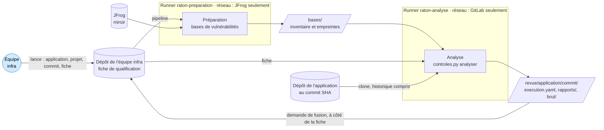

# Contrôles déterministes et outillage

Statut : **proposé** le 2026-11-13, à valider.

Les contrôles déterministes sont confiés à des outils : secrets, chaîne d'approvisionnement, analyse statique du code (SAST), identité et accès, palier Kubernetes. Lancés deux fois sur le même commit, ils donnent les mêmes constats. Ils produisent les preuves auditables de la revue ; les agents relecteurs viennent ensuite et couvrent ce que les outils ne voient pas (voir les [principes](feuille-de-route.md#principes-directeurs)).

Ce document décrit l'outillage commun : où le pipeline tourne, l'image, le réseau, la conversion des sorties d'outils en rapports. Il décrit aussi le premier contrôle outillé, celui des **secrets**. Les autres suivront un par un, chacun avec ses outils, ses règles et un cas du corpus.

Il s'appuie sur les réponses de l'équipe infra du 2026-11-13 :

1. un runner GitLab dédié, dans Kubernetes ;
2. GitLab Premium et JFrog Enterprise, mais pas d'outil de sécurité : Raton apporte les siens, Trivy au moins ;
3. JFrog sert de miroir pour les paquets, les images et les téléchargements ;
4. une phase de préparation télécharge les bases des outils, puis l'analyse tourne sans réseau ;
5. des applications en Python (FastAPI) et en JavaScript ou TypeScript (Next.js) ;
6. Keycloak en OIDC, avec un proxy d'authentification (oauth2-proxy) devant l'application ;
7. des secrets fournis par variables d'environnement, à défaut par fichiers ;
8. l'auteur arrive avec son Dockerfile et son chart Helm ;
9. des rapports d'outils jamais retouchés ;
10. des rapports rangés dans le dépôt de l'équipe infra, à côté de la fiche.

## Ce que l'outillage doit garantir

- **Reproductible.** L'image est épinglée par digest, chaque outil par sa version et sa somme SHA-256. Les bases de vulnérabilités sont datées, et leur empreinte figure dans le manifeste de l'exécution.
- **Rien du dépôt ne s'exécute.** Les outils lisent les fichiers ; ils ne construisent pas l'application et n'installent pas ses dépendances. Pendant l'analyse, le job ne joint que GitLab.
- **L'auteur ne règle pas les outils.** Raton passe sa propre configuration et neutralise les fichiers et les commentaires par lesquels le dépôt demanderait à un outil d'ignorer un résultat. Leur présence est elle-même un constat.
- **Un échec ne passe jamais pour une absence de constat.** Chaque contrôle a un statut dans le manifeste : fait, en échec ou pas encore outillé.
- **Aucun secret ne sort du job.** Rapports et sorties conservées masquent les valeurs.
- **Les rapports restent bruts.** Ni un LLM ni un humain ne les retouche : ce sont des preuves. Écarter un faux positif est une décision de l'équipe infra, enregistrée à part. C'est le registre des décisions reporté avec le [format des constats](formats/constats.md#reporté).

## Vue d'ensemble



## Où le pipeline tourne

**Dans le dépôt de l'équipe infra, jamais dans celui de l'application.** Le pipeline d'un dépôt se définit dans ce dépôt : l'auteur pourrait modifier la revue de son propre code. Raton fournit un modèle, [`ci/raton.gitlab-ci.yml`](../ci/raton.gitlab-ci.yml), que le dépôt de l'équipe infra inclut, épinglé sur un commit de Raton. On le lance avec quatre variables : le code de l'application, le chemin de son dépôt dans GitLab, le commit soumis et le chemin de la fiche validée.

**Deux runners dédiés dans Kubernetes**, un par phase, chacun dans son namespace :

| Runner | Voit | Réseau | Pourquoi |
|---|---|---|---|
| `raton-preparation` | aucun dépôt | JFrog seulement | télécharger les bases des outils, sans jamais voir le code |
| `raton-analyse` | le dépôt de l'application, la fiche | GitLab seulement | cloner le dépôt et déposer les artefacts |

Un outil compromis dans la phase d'analyse ne peut donc rien envoyer ailleurs que dans GitLab. Le code des applications métier peut être confidentiel ; c'est la raison de cette séparation.

**Configuration des runners** ([`ci/runners/config.toml`](../ci/runners/config.toml)) :

- chaque runner est verrouillé sur le projet de revue et ne prend que les jobs des branches protégées ;
- seule l'image d'outillage, désignée par son digest, est autorisée ;
- aucun conteneur privilégié, aucune élévation de privilèges, toutes les capacités Linux retirées ;
- les jobs tournent sous un utilisateur non root ;
- le compte de service n'a aucun droit sur l'API Kubernetes, et son jeton n'est pas monté.

**Réseau** ([`ci/runners/politiques-reseau.yaml`](../ci/runners/politiques-reseau.yaml)). Tout est refusé, puis chaque namespace reçoit le DNS du cluster et une seule destination, filtrée par son nom avec Cilium. Le job d'analyse a besoin de GitLab : le conteneur d'aide du runner y clone le dépôt et y dépose les artefacts, et il partage le réseau du pod du job.

**Accès au dépôt de l'application.** Le job clone avec son propre jeton (`CI_JOB_TOKEN`), qui expire avec lui. Il faut donc que chaque projet d'application autorise le projet de revue à utiliser ce jeton. À défaut, un jeton de déploiement de groupe en lecture seule peut convenir. Point à confirmer avec l'administration de GitLab.

## Les phases

### Préparation

Le job ne clone aucun dépôt (`GIT_STRATEGY: none`). Il télécharge les bases des outils par JFrog : aujourd'hui la base de vulnérabilités de Trivy, plus tard celles d'osv-scanner. Il en dresse ensuite l'inventaire, avec une empreinte par fichier et la date de mise à jour de la base. L'analyse reçoit ces bases comme artefact.

La base de Trivy servira à partir du contrôle de la chaîne d'approvisionnement ; la phase de préparation est en place dès maintenant pour que le pipeline ait sa forme définitive.

### Analyse

Le job clone le dépôt de l'application, avec tout son historique, sans hook ni sous-module, puis se place sur le commit soumis. Le jeton qui a servi au clone est aussitôt retiré de la configuration du dépôt. Puis `controles.py analyser` :

1. vérifie que le dépôt est bien au commit soumis, en lisant `.git` ;
2. lit la fiche : elle doit être validée, et c'est elle qui donne les contrôles à exécuter ;
3. lance les outils de chaque contrôle, convertit leurs sorties en rapports, valide les rapports et vérifie leurs preuves contre le dépôt ;
4. écrit le résultat :

```
revue/<application>/<commit>/
  execution.yaml                  manifeste : fiche, image, bases, statut de chaque contrôle
  rapports/secrets-gitleaks.yaml  un rapport par contrôle et par outil
  brut/gitleaks-arbre.json        sorties des outils, valeurs secrètes masquées
  brut/gitleaks-historique.json
```

Le job échoue si un contrôle n'a pas pu tourner, ou si une preuve d'un rapport est réfutée : ce serait un défaut de Raton. Il n'échoue pas parce qu'il y a des constats : c'est la synthèse qui en tire un avis. Les artefacts sont conservés dans tous les cas.

**Archivage.** L'équipe infra verse ce répertoire dans son dépôt, à côté de la fiche, par une demande de fusion. L'automatisation de cette étape est reportée : elle demande un jeton en écriture, à tenir hors du job d'analyse.

### Registre, à venir

Certains contrôles de la chaîne d'approvisionnement doivent interroger JFrog sur ce que le dépôt référence :

- le paquet existe-t-il, depuis quand, est-il populaire ?
- quelles sont les vulnérabilités de l'image de base ?

Un troisième job est proposé, au réseau limité à JFrog. Il ne reçoit que la liste extraite par l'analyse (noms de paquets, versions, références d'images), contrainte par un schéma, jamais le code. Il arrivera avec le contrôle de la chaîne d'approvisionnement ; seul son principe est à valider maintenant.

## L'image d'outillage

| Outil | Version | Sert à | Depuis |
|---|---|---|---|
| gitleaks | 8.30.1 | secrets dans l'arbre et l'historique git | ce contrôle |
| Trivy | 0.76.1 | base de vulnérabilités, puis CVE, licences, SBOM, configuration du Dockerfile et du chart | la préparation ; les contrôles suivants |
| osv-scanner | à choisir | CVE et paquets malveillants connus (base OpenSSF) | chaîne d'approvisionnement |
| Opengrep | à choisir | SAST, identité et accès, configuration externalisée | SAST |
| Python 3.13, git | image de base épinglée | scripts et règles de Raton, clone et historique | ce contrôle |

**Un outil n'entre dans l'image qu'avec son adaptateur, ses tests et un cas du corpus.** Trivy fait exception, pour la seule phase de préparation.

**Construction** ([`ci/Dockerfile`](../ci/Dockerfile)) :

- tout téléchargement passe par JFrog : archives des outils, paquets Python et paquets Debian ;
- la somme SHA-256 de chaque archive est écrite dans le Dockerfile, et le téléchargement échoue si elle ne correspond pas ;
- les dépendances Python sont installées avec leurs sommes ([`ci/requirements-image.txt`](../ci/requirements-image.txt)), en roues seulement, sans aucun paquet source à construire ;
- les scripts et les règles de Raton appartiennent à root, en lecture seule pour l'utilisateur des jobs.

### Mettre à jour un outil

Un outil de sécurité est une dépendance comme une autre. En mars 2026, la chaîne de publication de Trivy a été compromise : un binaire 0.69.4 piégé est resté disponible environ trois heures, des images 0.69.5 et 0.69.6 ont été publiées sur Docker Hub, et les tags de l'action GitHub `trivy-action` ont été réécrits ([CVE-2026-33634](https://osv.dev/vulnerability/GHSA-69fq-xp46-6x23)). D'où cette procédure :

1. **Choisir une version publiée depuis au moins 14 jours.** Ce délai de carence laisse le temps de découvrir une publication piégée. Trivy 0.76.1 a été choisi plutôt que 0.76.2, publié le 2026-11-05.
2. **Vérifier la signature** du fichier des sommes de la version (cosign, pour Trivy) avant d'en recopier la somme dans le Dockerfile.
3. **Mesurer avant d'adopter.** Lancer les tests et repasser le corpus avec la nouvelle image : un changement de version d'outil ne doit pas faire perdre de détection (voir la [boucle de mesure](architecture.md#1-un-même-pipeline-deux-usages)).
4. **Publier l'image** dans JFrog, puis changer le digest dans la variable `RATON_IMAGE` du projet de revue.

Les sommes de cette proposition ont été relevées le 2026-11-13 sur les fichiers de sommes publiés. Leurs signatures n'ont pas été vérifiées dans cette session : c'est la première chose à faire avant de construire l'image.

À surveiller : l'auteur de gitleaks a annoncé que l'outil était complet et ne recevrait plus que des correctifs de sécurité ; il désigne Betterleaks comme successeur. En changer demandera un nouvel adaptateur, mesuré sur le corpus comme tout changement d'outil.

## Les demandes d'ignorer de l'auteur

Chaque outil sait lire, dans le dépôt qu'il analyse, des fichiers ou des commentaires qui lui demandent d'ignorer des résultats. Une IA qui fait taire un outil plutôt que de corriger le problème, ou un auteur qui cache un secret, s'en servent. Raton les neutralise :

| Outil | Ce que le dépôt peut contenir | Ce que fait Raton |
|---|---|---|
| gitleaks | `.gitleaks.toml` à la racine | passe sa configuration par `--config`, qui l'emporte ; l'arbre analysé est une copie sans ce fichier |
| gitleaks | `.gitleaksignore` à la racine, que gitleaks charge toujours, quelle que soit l'option passée | analyse une copie de l'arbre sans ce fichier, et l'historique sur un miroir sans arbre de travail |
| gitleaks | commentaires `gitleaks:allow` | `--ignore-gitleaks-allow` |
| Trivy, à venir | `.trivyignore`, `trivy.yaml` | options explicites, lancement depuis un répertoire vide |
| osv-scanner, à venir | `osv-scanner.toml` | configuration explicite |
| Opengrep, à venir | `.semgrepignore`, commentaires `nosemgrep` | options explicites, commentaires désactivés |

Les outils tournent aussi avec un environnement vide : aucune variable du job ne leur parvient, ni un jeton comme `CI_JOB_TOKEN`, ni une variable de configuration comme `GITLEAKS_CONFIG`.

Chaque demande trouvée devient un constat `injection_relecteurs`, de sévérité basse, avec la règle `raton:suppression:<outil>`. Ce qu'elle aurait caché figure dans le même rapport. L'extrait cité masque le contenu des chaînes et les longues valeurs, car une liste d'exceptions peut contenir le secret qu'elle veut cacher.

## Des sorties d'outils aux rapports

- **Un rapport par contrôle et par outil**, au [format des constats](formats/constats.md) : `rapports/<contrôle>-<outil>.yaml`. Si deux outils couvrent un même contrôle, la synthèse rapproche leurs constats.
- **L'adaptateur lit la sortie la plus complète de son outil.** SARIF quand elle porte tout. Le JSON de l'outil sinon : pour gitleaks, il donne la valeur du secret, qu'il faut pour la masquer précisément, et SARIF range le commit dans des empreintes partielles. Pour Trivy et osv-scanner, il donnera le paquet, sa version et la version corrigée. C'est une précision de la décision 1 du format des constats, qui prévoyait SARIF partout.
- **Les sévérités suivent une table publique**, écrite dans l'adaptateur. Un outil ne donne jamais seul la sévérité `critique` : elle suppose une compromission avérée, qu'un humain constate. La confiance dépend de la précision de la règle.
- **Le périmètre est rempli par l'adaptateur** : ce que l'outil a couvert, et ce qu'il ne sait pas voir.
- **Chaque rapport est validé, et ses preuves sont vérifiées** contre le dépôt avant d'être écrites (`constats.py`). Le manifeste compte les constats vérifiés, réfutés et non vérifiables.
- **Les sorties brutes sont conservées**, valeurs masquées, sans l'identité ni les messages des auteurs de commits : le commit suffit à les retrouver.

### Manifeste d'exécution

`execution.yaml` dit avec quoi la revue a été faite. Le schéma fait foi : [`execution.schema.json`](../plugin/schemas/execution.schema.json).

| Champ | Contenu |
|---|---|
| `application`, `commit`, `date` | ce qui a été relu, et quand |
| `fiche` | empreinte du fichier de la fiche et palier : un avis vaut pour une version de la fiche |
| `image` | image d'outillage, nom et digest |
| `historique` | historique complet ou clone superficiel, nombre de commits |
| `bases` | fichiers préparés, avec leur empreinte et, pour une base de vulnérabilités, sa date |
| `controles` | pour chaque contrôle exigé par la fiche : outil et version, statut, rapport, sorties brutes, nombre de constats et résultat de leur vérification ; un motif s'il n'a pas été fait |

Statuts : `fait` (l'outil a tourné, son rapport est valide), `echec` (l'outil n'a pas tourné jusqu'au bout, ou son rapport est invalide), `non_outille` (la fiche exige le contrôle, aucun outil ne le réalise encore).

Exemple pour le cas [`notes-de-frais`](../corpus/notes-de-frais/). L'empreinte de la fiche est celle du corpus ; l'image, les bases et le nombre de commits sont des valeurs d'illustration :

```yaml
format: raton/execution/v0
application: notes-de-frais
commit: 4e3d3e49bc553b5ff0d6f7203f4791cf783997fb
date: 2026-11-13T10:00:00Z
fiche:
  empreinte: sha256:681f93ad0b547839d9f90d7322b1855970753e9641dc14b0cc4c4197100633de
  palier: 3
image: jfrog.example.com/raton/outillage@sha256:2f9c4e1a7b3d5f8e0c6a9b2d4f7e1c3a5b8d0f2e4c6a8b1d3f5e7c9a2b4d6f8e
historique: { complet: true, commits: 12 }
bases:
  - { fichier: trivy/db/metadata.json, empreinte: "sha256:8d2e6f0a4c8b2e6f0a4c8b2e6f0a4c8b2e6f0a4c8b2e6f0a4c8b2e6f0a4c8b2e", date: 2026-11-13T06:12:34Z }
  - { fichier: trivy/db/trivy.db, empreinte: "sha256:1c5a9e3b7d1f5a9e3b7d1f5a9e3b7d1f5a9e3b7d1f5a9e3b7d1f5a9e3b7d1f5a" }
controles:
  - controle: secrets
    outil: { nom: gitleaks, version: 8.30.1 }
    statut: fait
    rapport: rapports/secrets-gitleaks.yaml
    brut: [brut/gitleaks-arbre.json, brut/gitleaks-historique.json]
    constats: 0
    verification: { verifies: 0, refutes: 0, non_verifiables: 0 }
  - { controle: chaine_approvisionnement, statut: non_outille, motif: aucun outil ne réalise encore ce contrôle }
  - { controle: sast, statut: non_outille, motif: aucun outil ne réalise encore ce contrôle }
  - { controle: identite_acces, statut: non_outille, motif: aucun outil ne réalise encore ce contrôle }
  - { controle: palier_kubernetes, statut: non_outille, motif: aucun outil ne réalise encore ce contrôle }
```

## Contrôle des secrets

### Ce qui est analysé

- **L'arbre au commit relu.** gitleaks analyse une copie du dépôt sans `.git`, sans liens symboliques, sans fichiers spéciaux, et sans les fichiers de la racine qui le configureraient. Un lien symbolique pourrait désigner un fichier du job ; il n'est jamais suivi.
- **L'historique jusqu'au commit relu**, sur un miroir du clone : un secret retiré du code reste lisible par toute personne qui a accès au dépôt.
- **Les règles :** celles de gitleaks par défaut, plus une règle de Raton pour les identifiants dans une URL (`postgresql://utilisateur:motdepasse@hôte`), fréquents dans le code produit par une IA ([`plugin/regles/gitleaks.toml`](../plugin/regles/gitleaks.toml)). Aucune exception ne vient de l'auteur.
- **Les contenus encodés** (base64, par exemple), décodés sur deux niveaux. Les fichiers de plus de 10 Mo sont ignorés.

### Constats

Un secret fait un constat, quel que soit le nombre d'endroits où il figure : au commit relu d'abord, puis dans les commits de l'historique, dans la limite de 20 preuves.

| Situation | Catégorie | Sévérité | Confiance | Preuve |
|---|---|---|---|---|
| Secret au commit relu | `secret_expose` | haute | élevée pour une règle propre à un fournisseur, moyenne pour des identifiants dans une URL, faible pour la règle générique | `code` : lignes et extrait masqué, vérifiés contre le dépôt |
| Secret retiré du code, présent dans l'historique | `secret_expose` | haute | idem | `historique` : commit, fichier, lignes, extrait masqué |
| Demande d'ignorer adressée à gitleaks | `injection_relecteurs` | basse | élevée | `code` |

**Haute, jamais critique.** L'outil ne sait pas si le secret est celui de la production, ni s'il est encore valide : il ne l'essaie pas. L'équipe infra relève la sévérité si c'est le cas. Un secret de l'historique est compromis tant qu'il n'a pas été changé ; le retirer de l'historique ne suffit pas.

**Masquage.**

- La valeur est remplacée par `***` dans l'extrait. Pour une clé PEM, les lignes `BEGIN` et `END` restent lisibles : elles ne sont pas secrètes et rendent l'extrait probant.
- Quand la valeur n'apparaît pas telle quelle dans le fichier, par exemple un secret encodé en base64, Raton masque toutes les chaînes et les longues valeurs de la ligne.
- Les autres secrets trouvés sur les mêmes lignes sont masqués aussi.
- S'il ne reste rien de probant, la preuve devient une preuve d'historique au commit relu, sans extrait.
- Dernier filet : la conversion est refusée si un secret de 8 caractères ou plus figure encore dans le rapport.

**Les valeurs ne quittent pas le job.** gitleaks tourne sans `--redact` pour que Raton puisse masquer chaque valeur exactement, y compris sur une ligne qui en contient plusieurs. Sa sortie reste dans le répertoire temporaire du job, à côté du dépôt qui contient déjà ces secrets, et disparaît avec lui. Seules des copies masquées sont conservées.

**Périmètre déclaré non vérifié :** les secrets sans motif reconnaissable (mot de passe court, valeur sans préfixe), le contenu des archives, la validité des secrets, les secrets des dépendances et de l'image construite, et les branches qui ne mènent pas au commit relu. S'y ajoute l'historique antérieur au clone, si le clone est superficiel.

### Secrets en production

Le standard retenu : les secrets arrivent par des variables d'environnement, à défaut par des fichiers montés, jamais par le code ni par l'image. Deux conséquences :

- **Une valeur par défaut dans le code est un écart**, même quand le secret est aussi lu dans l'environnement : `os.environ.get("TOKEN", "<valeur>")` part en production si la variable manque. gitleaks n'en voit que les cas où la valeur a un motif reconnaissable. Le reste viendra avec les règles d'Opengrep : lecture de la configuration, valeurs par défaut, secrets écrits dans les journaux.
- **Une connexion directe au coffre devient inhabituelle.** La matrice de flux garde la destination `secrets` de la plateforme, pour qu'une telle connexion reste déclarable. Mais un flux vers elle sera signalé comme un écart au standard du SI (`non_conformite_si`), à justifier.

## Les contrôles suivants

| Contrôle | Outils | Ce qui sera vérifié |
|---|---|---|
| Chaîne d'approvisionnement | Trivy, osv-scanner, phase registre | lockfile présent, à jour, avec sommes (uv, poetry, pip ; npm, pnpm) ; versions épinglées ; scripts d'installation (`postinstall`, `setup.py`) ; CVE ; paquets malveillants connus ; paquets inexistants, très récents ou au nom proche d'un paquet populaire ; licences ; SBOM CycloneDX ; image de base |
| SAST | Opengrep, règles de Raton pour Python et FastAPI, JavaScript, TypeScript et Next.js | injections, SSRF, XSS, désérialisation, traversée de chemin ; configuration externalisée et valeurs par défaut |
| Identité et accès | Opengrep, règles de Raton | avec Keycloak et oauth2-proxy devant l'application : aucune authentification maison (mots de passe, émission de jetons, sessions) ; en-têtes d'identité du proxy acceptés seulement parce que l'application n'est joignable que par lui, ce que garantissent les politiques réseau générées depuis la matrice de flux ; droits accordés par les groupes Keycloak quand l'application en gère, à inscrire dans le palier |
| Palier Kubernetes | Trivy, règles de Raton | Dockerfile et chart Helm fournis par l'auteur : utilisateur non root, image de base par digest et venue de JFrog, `securityContext`, ressources, sondes, Pod Security Standards en mode restricted, ni `privileged` ni `hostPath` ; règles propres à FastAPI (serveur de production, rechargement désactivé) et à Next.js (`next start`, sortie autonome) ; chart rendu sans réseau |

## Ce que l'outillage ne voit pas

- Ce qui ne se voit qu'à l'exécution : une adresse construite à la volée, une connexion ouverte sous condition, ce que fait une dépendance à son installation. C'est le rôle de l'analyse dynamique.
- Le sens du code : une fonction non décrite, des données envoyées au bon service mais en trop. C'est le rôle des agents relecteurs.
- Ce que les règles ne connaissent pas encore. La mesure sur le corpus dit ce que chaque outil trouve, et ce qu'il manque.

## Outillage de Raton

[`controles.py`](../plugin/scripts/controles.py) :

- `analyser` est la phase d'analyse du pipeline ;
- `convertir gitleaks` convertit une sortie JSON de gitleaks, obtenue sans `--redact`, en rapport ;
- `suppressions` liste ce que le dépôt demande aux outils d'ignorer ;
- `inventorier` dresse l'inventaire des bases préparées ;
- `valider` contrôle un manifeste d'exécution.

gitleaks n'a pas pu tourner dans la session de développement : on n'y exécute pas de code téléchargé. Les conversions sont testées sur des sorties construites selon le format JSON documenté de gitleaks, et l'orchestration avec un faux gitleaks qui note ce qu'il reçoit : arguments, environnement, répertoire, fichiers visibles. La première exécution réelle se fera dans le pipeline de l'équipe infra ; ses écarts avec ces sorties construites seront corrigés dans l'adaptateur.

## Décisions à valider

1. **Le pipeline vit dans le dépôt de l'équipe infra**, avec deux runners dédiés : la préparation n'accède qu'à JFrog et ne voit aucun dépôt ; l'analyse n'accède qu'à GitLab.
2. **Une phase registre**, au réseau limité à JFrog, ne recevra que la liste des paquets et des images extraite par l'analyse. Seul son principe est à valider maintenant ; elle sera construite avec la chaîne d'approvisionnement.
3. **L'image** : un outil n'y entre qu'avec son adaptateur, ses tests et un cas du corpus. Délai de carence de 14 jours, sommes vérifiées, mesure sur le corpus avant toute mise à jour.
4. **Les demandes d'ignorer de l'auteur** sont neutralisées et deviennent des constats `injection_relecteurs` de sévérité basse.
5. **Un rapport par contrôle et par outil.** L'adaptateur lit le JSON de l'outil quand SARIF perd de l'information. C'est une précision de la décision 1 du format des constats.
6. **Les sévérités** : un outil ne donne jamais seul `critique` ; un secret, au commit relu comme dans l'historique, est de sévérité haute ; la confiance dépend de la précision de la règle.
7. **Le manifeste d'exécution** donne un statut à chaque contrôle (fait, en échec, pas encore outillé). Le job échoue sur un échec ou une preuve réfutée, jamais sur des constats.
8. **gitleaks tourne sans `--redact`** pour que Raton masque lui-même. Les sorties conservées sont masquées et ne gardent pas l'identité des auteurs de commits.
9. **Les secrets arrivent par variables d'environnement**, à défaut par fichiers. Une valeur par défaut dans le code est un écart. Un flux vers le coffre reste déclarable dans la matrice, mais signalé comme écart au standard du SI.
10. **Les contrôles 5 à 8 sont des jobs du pipeline, pas des skills.** Ils ne demandent ni entretien ni jugement : un script suffit. Claude intervient avant, pour constituer le dossier, et après, pour la revue par agents et la synthèse. Un skill pourra plus tard aider l'équipe infra à lire les résultats, ou l'auteur à lancer le pré-contrôle.

## Reporté

- **Cas du corpus pour les secrets**, à construire une fois l'outillage validé. Il doit avoir un vrai historique git : un jeton commité puis retiré, un mot de passe en valeur par défaut, une demande d'ignorer. Le dépôt du cas sera reconstruit à l'identique par un script, avec des dates et des auteurs fixés, pour que ses commits aient toujours le même SHA.
- **Archivage automatique** des rapports dans le dépôt de l'équipe infra, et lancement du pipeline depuis la demande de fusion qui soumet l'application.
- **Analyse de l'image construite** : la construire, c'est exécuter son Dockerfile ; elle relève du bac à sable de l'analyse dynamique.
- **Analyseur de secrets de Trivy** en second avis de gitleaks : à décider sur une mesure du corpus, pour ne pas doubler le bruit.
